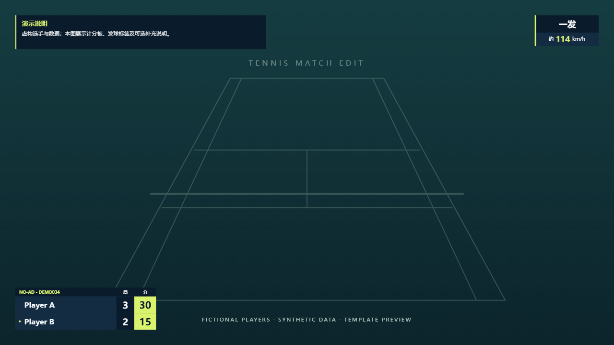
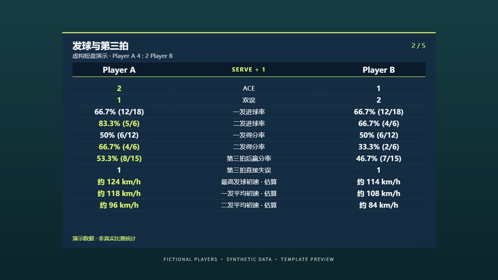
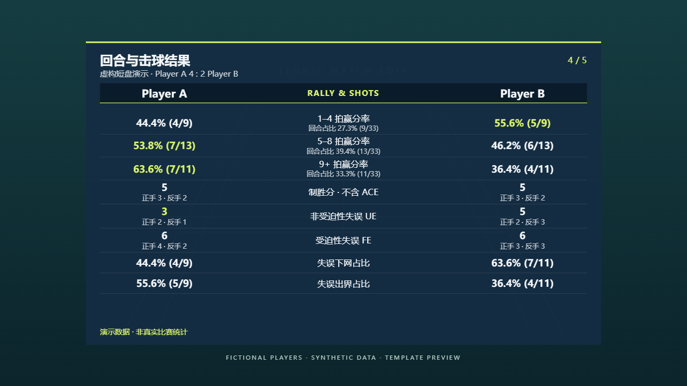

# Tennis Match Edit

**A reusable agent skill for turning tennis recordings into point-by-point edits,
auditable scoring, and compact match statistics.**

[中文说明](README.zh-CN.md) · [Skill entry](skills/tennis-point-edit-review/SKILL.md) · [Gallery](docs/gallery.md) · [Account sync](docs/synchronization.md)



*Every screenshot uses fictional Player A / Player B data and a generated court
illustration. No match footage, player identities or measured serve speeds are included.*

## What it does

- Cuts individual points while keeping the first dead ball and necessary reactions.
- Separates visual outcome, adopted ruling, rules-based score and onsite notation.
- Prioritizes the last effective point for game attribution while independently verifying the point-by-point chain; unresolved material questions remain on a usable review timeline.
- Provides full/review timeline toggles with one integrated local answer list; external editors use offline HTML.
- Derives five statistics pages from point and shot events, including FH/BH outcomes,
  independent UE/FE classification, and movement counts **within UE**.
- Estimates launch speed for every included serve, then adds post-contact speed labels.
- Reuses the navy/lime scoreboard, review labels, notes and statistics templates.
- Exports identity-bound originals through one H.264/AAC encode; precision checks use native ROI pixels and original PTS.
- Reclaims newly owned procedural images after persisted observations and key-evidence promotion through the [stage-cache lifecycle](skills/tennis-point-edit-review/references/stage-cache.md).

Rendered edits without a source timeline can use [deterministic seam reconstruction](skills/tennis-point-edit-review/references/rendered-video.md)
to propose editable clip ranges while preserving every frame. Cut detection is
separate from tennis point recognition; invisible edits and ambiguous transitions
still require inspection. Before outcome recognition, the skill prepares an
[initial labeling surface](skills/tennis-point-edit-review/references/initial-labeling.md).
The default is agent-dominant work; human-first mode lets you start manually in
offline HTML or the local workbench and hand back complete or partial answers.

The workflow resumes from the current stage and defaults to stage checkpoints,
with inspected deliverables, the current/next stage, and a question asking whether to proceed.
When stage 2 needs human review, continue through stage 3 and deliver its verified
review timeline and chosen answer surface together before waiting for review answers.
An explicit request enables continuous execution; required references and checks
still apply. Stage 1 delivers the complete point-cut timeline and keeps its ledger
as an internal log. Stage 2 performs point adjudication, scoring and basic graphics.
Stages 3–4 repeat review and recalculation as needed. Stage 5 prepares all statistics,
speeds and timing; stage 6 builds panels and speed overlays together; stage 7 verifies
the result. Later exception review covers unresolved points or problem games that still disagree
with the supplied final score after the agent's own checks.

After editing is complete and the user's final export succeeds, the agent lists
job-specific disposable files and asks whether to clean them up. Deletion requires
explicit confirmation, including in continuous mode. The [cleanup workflow](skills/tennis-point-edit-review/references/cleanup.md)
preserves original media, the final video, statistics, the reopenable project and
its dependencies, and all skill content; it verifies integrity and reports net freed space.

Current skill revision: **2026.10.28-v27.0**. See the [bilingual serve-speed explanation](docs/serve-speed-explained.md) for event timing, collision handling, physics, required recovery attempts, complete 3D screening and evidence-only/N/A labels.

The [comprehensive serve-speed architecture](skills/tennis-point-edit-review/references/serve-speed-pipeline.md) adds joint toss/contact/flight reconstruction, separate source/capture clocks, full 3D path integration and [conditional uncertainty](skills/tennis-point-edit-review/references/serve-speed-uncertainty.md). The [API guide](skills/tennis-point-edit-review/references/serve-speed-joint-api.md) distinguishes implemented helpers from reviewed camera/tracking/render adapters. Synthetic recovery tests demonstrate numerical behavior, not radar accuracy.

ChatCut, **Premiere Pro** and a standalone pipeline are primary editing choices.
The [environment contract](skills/tennis-point-edit-review/references/editing-environments.md)
selects an editor separately from its graphics implementation. Premiere has explicit
legacy CEP/ExtendScript and newer UXP routes, with a terminal-only interaction
contract and fresh-machine setup guidance. The agent does not need Computer Use.
The [Premiere guide](skills/tennis-point-edit-review/references/premiere-pro.md)
contains setup and execution instructions; the
[graphics contract](skills/tennis-point-edit-review/references/graphics-adapters.md)
covers editable native graphics and rendered overlays. Default hybrid graphics
combine native editable scores/labels where qualified with rendered statistics.
Available graphics controls depend on the host version and template; the agent
checks these before building the timeline.

The standalone [Courtside workbench](skills/tennis-point-edit-review/references/local-editor.md)
ships inside the skill: a local timeline, source/edited playback, decoded frame stepping,
cursor-snapping clip trims, Ctrl/⌘ multi-selection, Shift range selection, fit-to-view logarithmic zoom, game-lane navigation, overlay timing, full/review ripple-hide views and revisioned JSON handoff. Export the full master timeline or join selected clips in master order; review/playhead focus stays independent of the export selection. User exports are always available; only unsolicited agent renders wait for outcome and statistics confirmation to avoid redundant temporary videos.
Agents operate it entirely through the bundled CLI; users review in a browser.

## Preview





The default panel has **5 pages, 39 main comparison rows, 8 seconds per page**.
Higher/lower comparison rules choose the highlighted main value; descriptive
distributions stay neutral. See [all five pages](docs/gallery.md).

New jobs use the saved checkout’s ignored `outputs/` folder, with one directory per
match. Explicit user directories take priority. See [job storage](docs/job-storage.md)
for CLI defaults and verified relocation.

## Install and use

This repository keeps its independently installable package under
`skills/tennis-point-edit-review/`. From a clone, a compatible Skills CLI can install it:

```sh
npx skills add . --skill tennis-point-edit-review
```

Local-path installation is supported by the [Skills CLI](https://github.com/vercel-labs/skills).
You can also copy the **whole skill folder**, including references, examples and
scripts, into a skill directory supported by your agent.

In ChatCut, ask the connected agent to save/update this folder as your personal
workflow Skill, then select it from **My Skills**. A generic skill installation
does not install ChatCut's editing capabilities: actual editing needs a connected
video editor, media access and visual inspection.

Example request:

> Use the skill at `<skill-folder>/SKILL.md` to edit `<source-video>` in Premiere Pro.

The editor choice is optional. The agent reads the workflow and setup guidance
from the complete skill package, inspects the media and available tools, and
asks only for necessary unresolved information or a required manual setup step.

## Repository layout

```text
skills/tennis-point-edit-review/  Complete portable skill package
  SKILL.md                      Workflow entry and required references
  references/                   Match rules, workflow and editor setup
  examples/                     Seven canonical JSX components and review HTML
  scripts/                      Evidence, scoring, aggregation and checks
                                Optional Premiere interchange, terminal MCP and graphics adapters
demo/                           Reproducible fictional data and screenshot renderer
docs/                           Gallery, publishing and synchronization guides
tools/                          Validation, packaging and conflict-aware snapshot sync
.github/workflows/              Automated validation
```

## Reproduce the demonstrations

Python 3.10+ and Node.js 20+ are used for repository maintenance.

```sh
python -m pip install -r requirements-dev.txt
npm ci
npm run demo:build
npm run demo:capture
python tools/validate.py
npm run check:adapters
```

The renderer compiles the **actual JSX templates**, with a fixed preview frame.
Screenshots are captured by Playwright CLI; no alternate hand-drawn panels are used.
A local browser is required; if none is available, install one using
`npx playwright-cli install-browser chromium`.
Generated working pages are ignored under `output/playwright/`; selected PNGs
are kept under `docs/images/`. See [demo notes](demo/README.md).

## Maintain one source and sync deliberately

Use this Git repository as the durable, reviewable source. The account-saved Skill
is a reusable copy managed by ChatCut, **not a Windows folder that Git can watch**.

You can still update the account first, then ask an agent to retrieve its complete
package, compare it with this repository, merge changes, run checks, and commit.
That is an explicit sync operation, not automatic bidirectional synchronization.
The included helper handles exported files and conflicts; it does not log in to
ChatCut or push to GitHub. See [the synchronization guide](docs/synchronization.md).

## Scope and limits

Designed for singles: regular/short sets, advantage/no-ad, timed play and point
tiebreaks. Doubles requires explicit rule and service-order adaptation.
Scoring and stroke classifications require source evidence; estimated serve
launch speeds are not radar measurements. Unknown observations remain unknown.

## Contributing and license

Read [CONTRIBUTING.md](CONTRIBUTING.md). Code, skill text and original demo assets
are available under the [MIT License](LICENSE). External articles, brands and
installed dependencies retain their own licenses; see [notices](THIRD_PARTY_NOTICES.md).

Repository organization draws on the self-contained skill folders used by
[Anthropic Skills](https://github.com/anthropics/skills) and
[Remotion Skills](https://github.com/remotion-dev/skills). No upstream skill or
template code was copied for this packaging work.

## English and Chinese output

All seven overlay templates, five statistics pages (39 rows), review HTML and
comparison tables support English and Chinese presentation. The agent uses the
main interaction language unless a rendering language is explicitly requested.
The studio UI language remains independent. See the [output-language guide](skills/tennis-point-edit-review/references/output-language.md)
for API options, terminology and regeneration rules.
